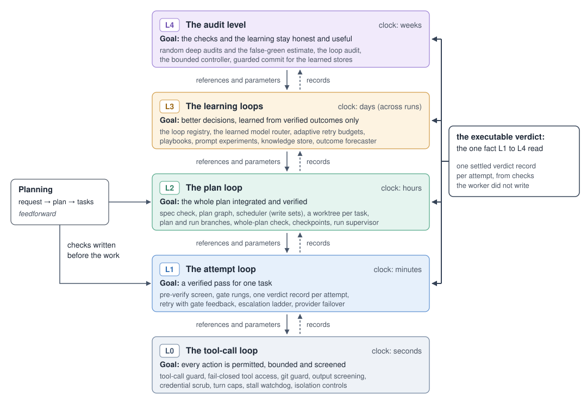

Status: reviewed · budget 900 words · owner spec-ce1484

# 5 The loops above the work

This section sets out Roko's five loops and describes the slowest two: the learning loops and the audit level.

## 5.1 Five loops nested by time scale

Figure 2 shows the five loops with their clocks and goals. Each steers toward a reference written before it acts;
slower loops set the references and parameters of faster ones, and faster loops leave records that slower ones read.

**Figure 2:** Five loops nested by time scale, with planning feeding forward into the attempt and plan loops.

## 5.2 The learning loops

Learners take an attempt's success from one fact: the learning label on its settled verdict record (§6.1). Credit
follows execution: the router is credited only when the provider reports running its pick, and a playbook or knowledge
entry only when the prompt included it. Learning changes which model runs, what prompts contain and a few settings
within declared ranges, never model weights, checks, tools or spending budgets.

Each loop declares a contract in the loop registry: the decision it changes, its default policy (that decision without
learning), when it can act, and a receipt proving that its state reached an executed request.

- **The learned model router** picks the model when no flag, hint or ladder rung decides, learning in stages from a
  role-to-model table to a contextual bandit [@li2010contextual]. Failures earn zero reward, and a small share of
  random choices (5% by default, at most 10%), logged with their probabilities, keeps it open to unbiased offline
  evaluation.[^5-explore]
- **Adaptive retry budgets** set the retries of a task whose author gave none from each gate rung's pass rate, never
  below what climbing the ladder takes.
- **Playbooks** are learned "when …, then …" hints, credited with the label of each attempt that used them.
- **Prompt experiments** draw each attempt's variant of a prompt section at random, logging the odds, and conclude
  once a confidence sequence over the labels puts one variant above the rest.
- **The knowledge store** distils verified passes into typed entries, promotes them as confirmations accumulate, and
  retrieves relevant ones into prompts; agent claims count only with evidence.
- **The calibrated outcome forecaster** (the self-model) predicts each candidate's chance of a verified pass, cost and
  latency, is scored against the label, and routes to the cheapest candidate that clears a confidence target within
  budget. It can only add checking, and it runs in shadow at first and whenever it scores worse than the base rate.

## 5.3 The audit level

The loops below trust that passes are right and that learners help, though visible tests and a loop's own metrics can
mislead (§2.3, principles 3 and 5). The audit level watches from outside the paths it judges.

**Random deep audits** play the role of Beer's System 3\*, the sporadic audit that inspects operations directly
instead of trusting their reports [@beer1979heart]. A keyed lottery that no agent can predict draws passed attempts,
each with at least a 5% chance,[^5-audit] and re-checks them in a fresh worktree: hidden tests written from the spec by
another model family, a clean re-run, tamper checks and mutation. A Hájek estimate, weighting each audit by the
inverse of its draw probability [@horvitz1952generalization], gives the false-green rate with a Wilson interval
[@wilson1927probable]. It sets verification depth and how far each model is trusted (§6).

**The loop audit** checks that each registered loop, the regulators included, earns its place. A keyed-hash holdout
sends some task chains to the default policy (20% on probation, 5% once live, never below 2%),[^5-holdout] and the
audit measures exposure (does the state reach decisions?), influence (does it change them beyond rerun noise?) and
benefit (are outcomes better?). A loop whose state never reaches a decision shows a reach failure. A loop that shows
no benefit is flagged, and reverts to its default policy once a person turns enforcement on.

**The bounded controller** applies Ashby's ultrastability [@ashby1960design]: it changes faster loops' settings only
when an essential variable leaves its bounds. It watches the four essential variables (§2.3) against bounds people
set, and does nothing inside them. On a confirmed breach it moves one setting one notch, keeps the move if the breach
shrinks, and otherwise rolls back to the last known good setting. It starts in shadow mode until a person switches it
on. A safety box sits outside its search: no move widens permissions, removes an authored check or raises a budget
ceiling.

**Guarded commit** keeps what a run taught the router, the knowledge store or the controller only if it passes that
store's checks, such as doing no worse than the last known good version on held-out attempts and honouring anchor
cases that people write; otherwise it restores that version. For the router and the knowledge store it first
observes, recording the rollback it would make, until a person switches it to enforce. Without regression control,
one harness optimizer fell below its baseline on new tasks and another stopped improving [@wang2026compound].

The four link through records: audited labels train the forecaster, the false-green estimate is one of the
controller's variables, and a move that cuts cost or checking raises the audit rate.

[^5-explore]: Design defaults (`5e32264ce`): the exploration rate and its cap in
    `crates/roko-learn/src/loop_audit/assign.rs`.
[^5-holdout]: Design defaults (`5e32264ce`): the holdout schedule by audit state, and its floor, in
    `crates/roko-learn/src/loop_audit/assign.rs`.
[^5-audit]: Design default (`5e32264ce`): `AUDIT_FLOOR`, a locked floor, in `crates/roko-core/src/config/audit.rs`.
